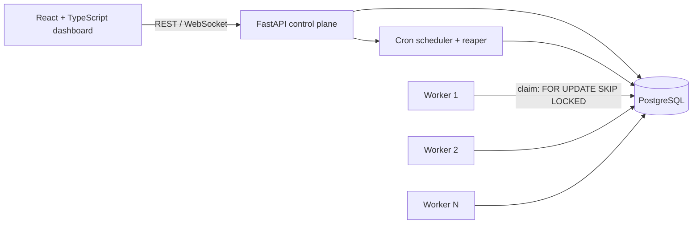

# Distributed Job Scheduler

[](https://github.com/Visheshmak/distributed-job-scheduler/actions/workflows/ci.yml)


A distributed background-job platform that runs immediate, scheduled, recurring (cron) and batch jobs across a fleet of workers. It handles retries with backoff, a dead-letter queue (DLQ), worker heartbeats and crash recovery, and has a real-time React dashboard.

It uses **PostgreSQL as the message broker** (`SELECT ... FOR UPDATE SKIP LOCKED`), so there is no RabbitMQ, Kafka or Celery to run.

---

## Highlights

| Area | What it does |
| --- | --- |
| **Atomic job claiming** | Workers claim jobs with `FOR UPDATE SKIP LOCKED`, so a job is never executed twice even with many concurrent workers. Covered by multi-worker race-condition tests. |
| **Retries & DLQ** | Fixed, linear, and exponential backoff with jitter per retry policy. Jobs that exhaust `max_retries` move to the DLQ and can be replayed or archived. |
| **Scheduling** | Immediate, delayed, recurring (cron via `croniter`) and batch submission. |
| **Worker lifecycle** | Heartbeats, a reaper that recovers jobs from dead workers, graceful shutdown (drain in-flight jobs on `Ctrl+C`), and on-demand worker spawning from the dashboard. |
| **Queue control** | Per-queue concurrency, pause / resume, and priority. |
| **Observability** | Request/execution correlation IDs, structured logging, Prometheus metrics endpoint, health probes, and a full per-job execution timeline. |
| **Security** | JWT authentication, bcrypt password hashing, and API rate limiting (`slowapi`). |

## Architecture



- **Control plane:** a FastAPI service that accepts job submissions, manages queues and retry policies, schedules cron jobs, and serves metrics.
- **Data plane:** standalone `worker_cli.py` processes that poll PostgreSQL, claim jobs in batches, execute them concurrently with `asyncio`, and send heartbeats.
- **Dashboard:** a React + Vite single-page app for queues, workers, the job explorer, and the DLQ.

## Tech Stack

- **Backend:** Python 3.12, FastAPI, Pydantic v2, SQLAlchemy 2.0 (async), asyncpg, PyJWT, Passlib (bcrypt), croniter, prometheus-client, slowapi
- **Database:** PostgreSQL 16 (production) / SQLite (local development and tests)
- **Frontend:** React 18, TypeScript, Vite, Recharts, Lucide Icons
- **Testing:** pytest, pytest-asyncio, httpx (unit, API, retry-math, and concurrency tests)
- **DevOps:** Docker, Docker Compose, GitHub Actions CI

## Getting Started

### Option 1: Docker Compose (recommended)

Starts PostgreSQL, the API, two workers, and the dashboard:

```bash
docker compose up --build
```

| Service | URL |
| --- | --- |
| Dashboard | http://localhost:5173 |
| API | http://localhost:8000 |
| Interactive API docs (Swagger) | http://localhost:8000/docs |

### Option 2: Run locally

```bash
# Backend
cd backend
python -m venv .venv
source .venv/bin/activate        # Windows: .venv\Scripts\activate
pip install -r requirements.txt
export DATABASE_URL="sqlite+aiosqlite:///./jobscheduler.db"   # or a PostgreSQL URL
uvicorn app.main:app --reload

# Extra workers (optional, in new terminals)
python worker_cli.py --worker-id worker-02 --concurrency 5

# Frontend
cd frontend
npm install
npm run dev
```

Tables, a demo organization/project, default queues, and retry policies are created automatically on first startup.

> **Demo login:** `admin@scheduler.io` / `admin123`. These are seeded for local development only; change them before deploying anywhere.

### Run the tests

```bash
cd backend
pytest -q
```

## API Overview

All endpoints are versioned under `/api/v1`. See `/docs` for the full OpenAPI spec.

| Resource | Endpoints |
| --- | --- |
| Auth | `POST /auth/register`, `POST /auth/login`, `GET /auth/me` |
| Jobs | `POST /jobs`, `POST /jobs/batch`, `GET /jobs`, `GET /jobs/{id}/detail`, `POST /jobs/{id}/retry`, `POST /jobs/{id}/cancel` |
| Queues | `POST /queues`, `GET /queues`, `PATCH /queues/{id}`, `POST /queues/{id}/pause`, `POST /queues/{id}/resume` |
| Retry policies | `POST /queues/retry-policies`, `GET /queues/retry-policies` |
| Workers | `GET /workers`, `GET /workers/{id}`, `POST /workers/spawn` |
| Dead-letter queue | `GET /dlq`, `POST /dlq/{id}/replay`, `POST /dlq/{id}/archive` |
| Metrics | `GET /metrics/overview`, `GET /metrics/prometheus` |

## Demo Walkthrough

1. Open the dashboard at http://localhost:5173.
2. **Queues:** see the seeded `default`, `critical-payments`, and `bulk-reports` queues.
3. Click **Demo Batch** and watch jobs spread across workers in the **Workers** tab.
4. **Job Explorer:** open a job to see its `QUEUED → CLAIMED → RUNNING → COMPLETED` timeline.
5. Submit a `FLAKY_TASK` job and watch it fail on attempt 1, back off, then succeed.
6. Submit an `ALWAYS_FAIL` job and watch it exhaust its retries and land in the **DLQ**. Then click **Replay**.
7. **Pause** a queue, submit a job (it waits), then **Resume** it.
8. Press `Ctrl+C` on a worker and watch it drain in-flight jobs before going `STOPPED`.

## Project Structure

```
backend/
  app/
    api/v1/        REST endpoints (auth, jobs, queues, workers, dlq, metrics)
    core/          config, database, security, logging, middleware
    models/        SQLAlchemy models
    schemas/       Pydantic request/response schemas
    services/      business logic (scheduling, retries, stats, DLQ)
    worker/        claiming, execution engine, heartbeats
  tests/           pytest suite
  worker_cli.py    standalone worker process
frontend/          React + TypeScript dashboard
docs/              design documentation
```

## Design Docs

- [Architecture overview](docs/project_structure.md)
- [Concurrency & atomic claiming](docs/how_multithreading_works.md)
- [Database design & indexing](docs/db_tables.md)
- [Reliability & failure handling](docs/error_handling.md)
- [Retry strategies & DLQ](docs/retries.md)
- [Observability & tracing](docs/monitoring_setup.md)
- [Architecture decision records](docs/why_we_chose_this.md)

## Author

**Vishesh Makwana**: [GitHub](https://github.com/Visheshmak) · [LinkedIn](https://linkedin.com/in/vishesh-makwana-15ba1b281)
