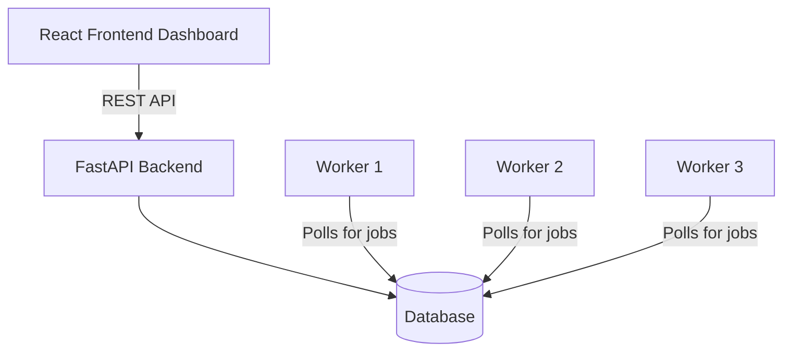

# Job Scheduler Architecture

## 1. Overview

The main idea of this project is to build a background job processing system using just PostgreSQL/SQLite. I didn't want to use Kafka or RabbitMQ because it adds too much complexity to set up for this project. Instead, the database acts as the message broker, which makes it easier to keep everything in sync (like the job status and the execution logs).

---

## 2. Main Parts of the Project

### 2.1 The Backend (FastAPI)
- **API Endpoints**: Used to create jobs, pause queues, and view failed jobs.
- **Validation**: Uses Pydantic to make sure the JSON requests are correct before saving to the DB.
- **Cron Supervisor**: A background task that runs every few seconds to check if any scheduled or cron jobs are ready to run, and moves them to the `QUEUED` state.

### 2.2 The Database
- Stores everything: Queues, Jobs, Retry Policies, and Logs.
- **Atomic Locking**: Uses `SELECT ... FOR UPDATE SKIP LOCKED` so that multiple workers can poll the database at the exact same time without accidentally claiming the exact same job.

### 2.3 The Workers
- Standalone python processes that poll the DB for jobs.
- They pull jobs based on Queue priority and execute them concurrently.
- They send a heartbeat every 5 seconds to show they are alive.
- If a worker crashes, the backend realizes the heartbeat stopped and re-queues the job.
